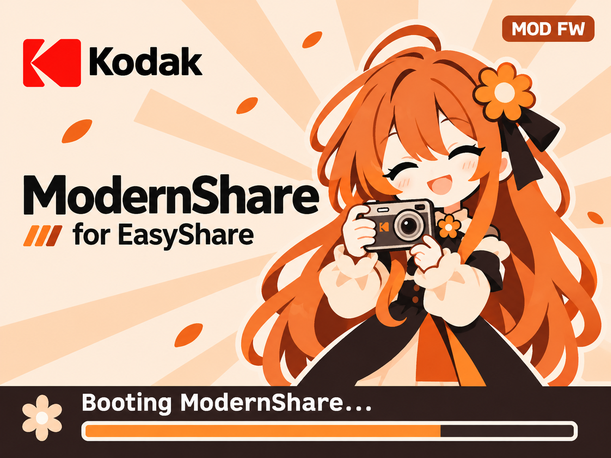

# ModernShare for Kodak EasyShare

An open-source firmware modification for a **Kodak CD703 running C713 firmware
1.30**. ModernShare adds direct DNG capture, selectable film looks and a useful
replacement for the discontinued Share-button workflow.

**0.8 is camera-confirmed by user report.** The source build reproduces the exact
tested firmware, SHA-256
`091663ac848b6ee07c2a9252b9a9662e8cc7c463275e2dde62edb10d8e0f6003`.
Compatibility with other camera models or firmware versions is not established.



## Features

- Share → **ModernShare**: Film first, DNG saving, hidden-menu shortcut, version
  and SD save/load status.
- JPEG film choices: By mode, Stock, Agfa Vista 200, Kodak E100VS, Fuji Neopan
  1600, Velvia 100 and Kodachrome 64. Looks are matrix approximations of film LUTs.
- Film effects in live view and new-shot Review previews.
- Direct sensor **DNG + JPEG**, with same-shot date/time, exposure, aperture and
  ISO. DNG keeps original sensor data and editable fixed daylight white balance.
- **DNG OFF by default**. Film and DNG choices save automatically to the SD card
  and restore after restart or battery-flap opening.
- Custom full-screen boot artwork, charcoal menus and flash OFF defaults.
- Date setup through 2037; fallback 2026-11-07 noon after RTC power loss.

## Generate firmware with the small app

**[Download ModernShare 0.8](https://github.com/Nacholmo/ModernShare/releases/tag/v0.8.0)** — ready-to-run apps, no Python or build tools required.

| Your computer | Download |
|---|---|
| Windows 10/11, 64-bit | [ModernShare.exe](https://github.com/Nacholmo/ModernShare/releases/download/v0.8.0/ModernShare-0.8-Windows-x86_64.exe) |
| Linux, 64-bit Intel/AMD | [ModernShare.AppImage](https://github.com/Nacholmo/ModernShare/releases/download/v0.8.0/ModernShare-0.8-Linux-x86_64.AppImage) |

1. Download the app for your computer. On Linux, open the file's Properties →
   Permissions and allow it to run as a program, then double-click it.
2. Download **[KC713130.exe from TousLesDrivers](https://www.touslesdrivers.com/index.php?v_page=23&v_code=19867&v_langue=en)**.
   Keep the updater file; you do not need to install it.
3. Open ModernShare, select `KC713130.exe`, choose an output folder and click
   **Generate firmware**.
4. Copy the generated `KC713.FW` to the SD card's `SYSTEM` folder, then use the
   camera's **UPDATE FIRMWARE** action.

The original updater
is read as an archive and is never executed. The app needs no assembler and
never replaces an existing output. The mirror's download and firmware hashes
were verified on 2026-11-08; see [download details](docs/GETTING_FIRMWARE.md).

Linux builds target Ubuntu 22.04 or a compatible newer distribution. The
[release page](https://github.com/Nacholmo/ModernShare/releases/tag/v0.8.0) also
includes checksums, source and licence notices. [GUI instructions](docs/GUI.md).

For a terminal-only workflow, with no third-party Python packages:

```sh
python3 modernshare_patcher.py /path/to/KC713130.exe --output /output/folder/KC713.FW
```

## Rebuild the modification from source

This repository contains modification source and patch recipes. **Kodak firmware,
updaters, memory dumps, personal photos and tool binaries are not distributed.**
Supply your own stock C713 1.30 image with SHA-256:

```text
06133ed6bc6272f6b1ab9c784723d9259c71cb4ef88b3defb6ed36f4a4e66c9b
```

Requirements: Python 3.11+, the packages below, and GNU ARC binutils (`as`,
`objcopy`, `objdump`; validated with binutils 2.43, `arc700` instructions).

```sh
python3 -m venv .venv
. .venv/bin/activate
python3 -m pip install -r requirements.txt
python3 scripts/build.py \
  --stock /path/to/kc713.fw \
  --arc-prefix /path/to/arc-elf32- \
  --outdir build/modernshare-0.8
```

If `arc-elf32-as`, `arc-elf32-objcopy` and `arc-elf32-objdump` are on PATH, omit
`--arc-prefix`. The stock file stays unchanged. The output directory must be new.
The builder reassembles the custom hooks from source, generates the DNG header,
computes the theme, encodes both PNG assets and copies required vendor data from
your local stock image. It checks all container sums and the final release hash
before writing `KC713.FW`.

For deliberate source or artwork changes, use `--allow-modified`. Such output is
marked **not camera-confirmed**. The small fixed-edit recipe and allocation map
are documented in [BUILDING.md](docs/BUILDING.md).

## Install and use

Use the supported camera and a charged battery. Keep a known working recovery
image. Copy your locally built `KC713.FW` to `SYSTEM/KC713.FW` on the SD card and
use the hidden menu's **UPDATE FIRMWARE** action. With ModernShare installed,
reach it through Share → Hidden menu. The updater renames a successfully flashed
file to `KC713.OLD`; its hash can confirm the installed build.

Press Share to change settings. OK on Film or DNG saves both choices. The fourth
row displays `defaults`, `SD loaded`, `SD saved` or `SD error` alongside v0.8.
The root files `KMOD0.CFG` / `KMOD1.CFG` belong to that card. Without valid files,
Film starts By mode and DNG stays OFF. Removing both files or formatting the card
restores those defaults. A saved DNG ON preference restores ON.

See [SD settings](mods/sd_settings/README.md), [architecture](docs/ARCHITECTURE.md),
[validation](docs/VALIDATION.md) and [development](docs/DEVELOPMENT.md).

## Repository contents

| Path | Purpose |
|---|---|
| `scripts/build.py` | Standalone source build from local stock firmware |
| `modernshare_gui.py`, `modernshare_patcher.py` | Windows/Linux updater-to-firmware app and standard-library CLI |
| `src/firmware/` | Final editable ARC assembly and layout constants |
| `src/release/` | Fixed-edit recipe, allocation map and runtime layouts |
| `mods/*/src/` | Original feature builders, fitters and emulator scripts |
| `mods/lut/looks/filmluts/` | Film-Luts assets and original MIT licence |
| `tools/` | Firmware inspection/checksum tool and legacy RAW→DNG converter |
| `decompiler-project/` | Annotation/model sources and analysis setup scripts |
| `docs/validation/0.8/` | Historical automated results and user camera acceptance |
| `tests/` | Public tests and metadata fixtures without personal photographs |

The original staged builders are retained for research and history; their old
workspace paths are not the standalone build interface. Use `scripts/build.py`.

## Licence

ModernShare's original code and documentation are licensed under
**GNU AGPL version 3 or any later version**. See [LICENSE](LICENSE) and
[NOTICE](NOTICE). Film-Luts retains its MIT licence. Ghidra-related upstream
material retains Apache-2.0 terms. Kodak firmware is external and is not
relicensed by this project. Project artwork does not grant rights to third-party
trademarks, logos or characters. See [THIRD_PARTY_NOTICES.md](THIRD_PARTY_NOTICES.md).

ModernShare is an independent project, unaffiliated with Kodak or the film brands.
