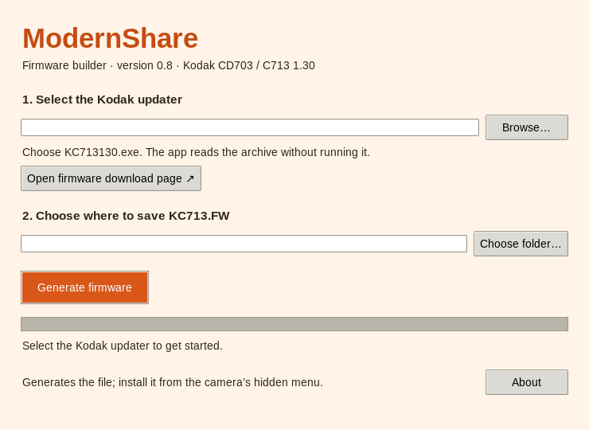

# Firmware builder for Windows and Linux

The small GUI takes the original **KC713130.exe** and produces the exact
**ModernShare 0.9 KC713.FW**. No compiler, assembler, NumPy,
Pillow or Kodak software is needed to use the GUI.



1. Download the updater from the [verified archive](GETTING_FIRMWARE.md).
2. Open ModernShare and browse to `KC713130.exe`.
3. Choose an output folder and click **Generate firmware**.
4. Copy the resulting `KC713.FW` to the SD card's `SYSTEM` folder, then use the
   camera's **UPDATE FIRMWARE** action.

The app does not run the updater or flash the camera. It rejects unsupported
firmware and never replaces an existing output. All generated bytes are verified
against the pinned release hash before they are saved and read back.
The download button opens the external listing in your browser; the app does not
silently fetch or bundle firmware.

## Run from source

For normal use, download the ready-made
[Windows executable or Linux AppImage](https://github.com/Nacholmo/ModernShare/releases/tag/v0.9.0).
The steps below are for developers or users who prefer running Python source.

```sh
python3 modernshare_gui.py
```

Python with Tkinter is sufficient. Windows python.org installers normally provide
Tk; Linux users may need their distribution's Tkinter package (`python3-tk` on
Debian/Ubuntu, `tk` with Python on Arch). The pure command-line variant requires
only the Python standard library:

```sh
python3 modernshare_patcher.py /path/to/KC713130.exe --output /output/folder/KC713.FW
```

## Build a standalone app

Build on the operating system you want to distribute for. PyInstaller does not
produce a Windows executable from a Linux build.

```sh
python3 -m pip install -r requirements-app.txt
python3 scripts/package_app.py --outdir /path/to/fresh/package-output
```

The `release/` directory contains `ModernShare-0.9-Windows-x86_64.exe` on Windows
or `ModernShare-0.9-Linux-x86_64.AppImage` on Linux, licence notices, checksums,
and a matching source archive. Build on each native platform. Linux packages use
an AppDir around a PyInstaller folder bundle and a hash-pinned, statically linked
type-2 AppImage runtime. Tool URLs/hashes are in `packaging/appimage/toolchain.json`.
The Linux CI runner is Ubuntu 22.04, avoiding a dependency on the developer's newer
glibc. Intel/AMD 64-bit Windows and Linux are the packaged targets.

The native GitHub workflow tests host behavior, the GUI flow, packaged Tk startup,
exact generated firmware, invalid inputs and preservation of existing outputs.
Release verification JSON files record the actual executable hashes and results.
CI runs AppImages in extract-and-run mode because hosted runners may not permit
FUSE mounting. The workflow uploads artifacts; maintainers publish a verified release.

## How the small app relates to the source build

The GUI applies `src/release/bundle-0.9.json`, a compact bundle of authored edits,
assembled hooks and generated assets. It contains no complete firmware image.
English text and preserved vendor graphics are rebuilt from the local input.
The runtime uses only standard-library helpers for sentence casing and RLE repacking. All preferred source, assembly, artwork and generator scripts are included.

To regenerate this bundle, first reproduce the verified release from source, then:

```sh
python3 scripts/package_bundle.py --stock /path/to/kc713.fw \
  --firmware /path/to/source-build/KC713.FW --out /path/to/new-bundle.json
```

The packager accepts only the pinned release hashes. This prevents a development
build from silently acquiring the confirmed GUI-release identity. New releases
need updated constants, source recipe, tests and camera confirmation.

## Tests

Host tests use generated ZIPs, damaged inputs, duplicate entries, path traversal
names, firmware-size bounds, checksum failures and existing-output protection.
Set `MODERNSHARE_STOCK` and optionally `MODERNSHARE_UPDATER` to your local files
to enable exact-output and original-SFX integration tests:

```sh
MODERNSHARE_STOCK=/path/to/kc713.fw \
MODERNSHARE_UPDATER=/path/to/KC713130.exe \
python3 -m unittest discover -s tests -v
```
